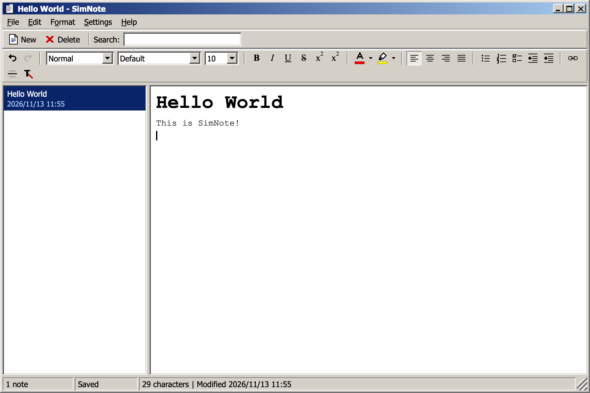

<div align="center">


# SimNote

A minimalist note-taking app with a retro 90s look.

[](https://github.com/panco1995/simnote/releases)
[](LICENSE)


</div>



## About

SimNote does one thing: **open it and write; close it and it's saved.**

The interface pays homage to 90s desktop software: blue gradient title bar, gray beveled borders, sunken text fields and checkerboard scrollbars. Built with [Tauri 2](https://tauri.app), a single codebase ships to macOS, Windows and Linux, and the installer is only about 3 MB.

## Features

- Create, edit and delete notes
- Rich text formatting: paragraph styles and headings, font, size, bold / italic / underline / strikethrough, superscript / subscript, font and highlight colors, alignment, line spacing, indent, bulleted / numbered lists, checklists, quotes, code blocks, links and horizontal lines
- Interface in English, 简体中文, 繁體中文 and 日本語 (Settings → Language)
- Automatic saving, no manual action needed
- The first line of a note becomes its title
- Instant full-text search
- Notes sorted by last modified time
- Keyboard friendly
- Data stays in a local JSON file: no network access, no telemetry

### Keyboard shortcuts

| Action             | Windows / Linux          | macOS        |
| ------------------ | ------------------------ | ------------ |
| New note           | `Ctrl+N`                 | `⌘N`         |
| Search             | `Ctrl+F`                 | `⌘F`         |
| Save now           | `Ctrl+S`                 | `⌘S`         |
| Undo / Redo        | `Ctrl+Z` / `Ctrl+Shift+Z` | `⌘Z` / `⇧⌘Z` |
| Bold / Italic / Underline | `Ctrl+B` / `Ctrl+I` / `Ctrl+U` | `⌘B` / `⌘I` / `⌘U` |
| Strikethrough      | `Ctrl+Shift+S`           | `⇧⌘S`        |
| Superscript / Subscript | `Ctrl+.` / `Ctrl+,` | `⌘.` / `⌘,`  |
| Insert link        | `Ctrl+K`                 | `⌘K`         |
| Open link          | `Ctrl`+click             | `⌘`+click    |
| Align left / center / right / justify | `Ctrl+Shift+L` / `E` / `R` / `J` | `⇧⌘L` / `E` / `R` / `J` |
| Bullets / numbering / checklist | `Ctrl+Shift+8` / `7` / `9` | `⇧⌘8` / `7` / `9` |
| Indent / outdent   | `Tab` / `Shift+Tab`      | Same         |
| Clear formatting   | `Ctrl+\`                 | `⌘\`         |
| Switch notes       | `↑` / `↓` in the list    | Same         |
| Edit selected note | `Enter` in the list      | Same         |
| Delete selected    | `Delete` in the list     | Same         |

## Download

Grab the installer for your platform from [Releases](https://github.com/panco1995/simnote/releases):

| Platform | File                                                        |
| -------- | ----------------------------------------------------------- |
| Windows  | `.msi` or `-setup.exe`                                      |
| macOS    | `.dmg` (`aarch64` for Apple Silicon, `x64` for Intel)       |
| Linux    | `.AppImage`, `.deb` or `.rpm`                               |

> **macOS note**: builds are not yet signed by Apple. If macOS says the app "is damaged" or "cannot be verified", run:
>
> ```bash
> xattr -cr /Applications/SimNote.app
> ```

## Where your notes live

All notes are stored in a single `notes.json` file that you can back up or sync freely:

| Platform | Path                                                        |
| -------- | ----------------------------------------------------------- |
| macOS    | `~/Library/Application Support/com.simnote.app/notes.json`  |
| Windows  | `%APPDATA%\com.simnote.app\notes.json`                      |
| Linux    | `~/.local/share/com.simnote.app/notes.json`                 |

Each note keeps a plain-text `content` (used for titles and search) alongside the formatted `html`.

## Building from source

### Prerequisites

- [Node.js](https://nodejs.org) 20 or later
- [Rust](https://www.rust-lang.org/tools/install) (stable)
- Platform dependencies, see the [Tauri prerequisites guide](https://tauri.app/start/prerequisites/)
  - **macOS**: Xcode Command Line Tools (`xcode-select --install`)
  - **Windows**: Microsoft C++ Build Tools + WebView2 (preinstalled on Windows 10/11)
  - **Linux** (Debian/Ubuntu):
    ```bash
    sudo apt install libwebkit2gtk-4.1-dev build-essential curl wget file \
      libxdo-dev libssl-dev libayatana-appindicator3-dev librsvg2-dev
    ```

### Develop and package

```bash
git clone https://github.com/panco1995/simnote.git
cd simnote
npm install

# Run in development mode with hot reload
npm run tauri dev

# Build an installer for the current platform
npm run tauri build
```

Build output goes to `src-tauri/target/release/bundle/`.

For UI-only work you can run `npm run dev` and open `http://localhost:1420` in a browser; notes are then stored in the browser's localStorage.

### Releasing a new version

The repository includes a GitHub Actions workflow (`.github/workflows/release.yml`). Pushing a tag that starts with `v` builds every platform automatically:

```bash
# Bump the version in package.json, src-tauri/Cargo.toml and src-tauri/tauri.conf.json first
git tag v0.1.0
git push origin v0.1.0
```

When the builds finish, a draft release appears on the Releases page. Review it and click Publish.

## Project structure

```
simnote/
├── index.html              # Window layout
├── src/
│   ├── main.ts             # App logic: notes, menus, dialogs, shortcuts
│   ├── editor.ts           # Rich text editor (TipTap) and formatting commands
│   ├── formatbar.ts        # Format toolbar, color palettes, toolbar/menu state
│   ├── i18n.ts             # UI translation
│   ├── style.css           # Retro 90s styling
│   ├── icons.ts            # Pixel-art SVG icons
│   └── storage.ts          # Storage layer (Tauri file / browser localStorage)
├── locales/                # Translations shared by the UI and the Rust side
├── public/icon.svg         # App icon source
├── src-tauri/
│   ├── src/lib.rs          # Rust side: reads and writes notes.json and settings.json
│   ├── src/i18n.rs         # Rust-side translation of returned messages
│   ├── tauri.conf.json     # Window and bundle configuration
│   ├── capabilities/       # Permissions exposed to the frontend
│   └── icons/              # Platform icons (generated by npx tauri icon)
└── .github/workflows/      # CI and automated releases
```

## Roadmap

- [x] basic note taking
- [x] i18n (multilingual support)
- [x] rich text editing

Ideas are welcome in [Issues](https://github.com/panco1995/simnote/issues).

## Contributing

Issues and pull requests are welcome. See [CONTRIBUTING.md](CONTRIBUTING.md).

## License

[MIT](LICENSE)
